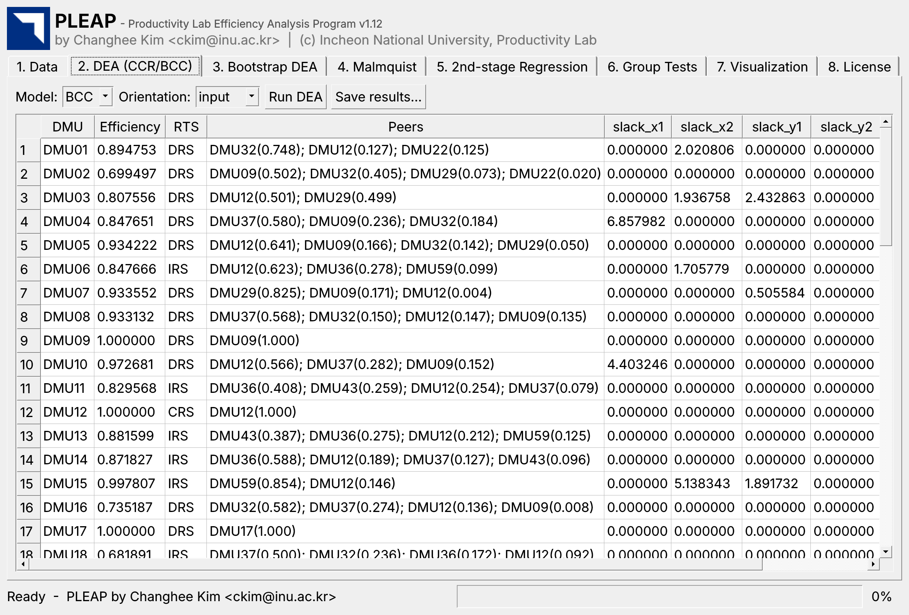

# PLEAP — Productivity Lab Efficiency Analysis Program

[](https://github.com/ProductivityLab/pleap/actions/workflows/ci.yml)
[](LICENSE.txt)
[](https://www.python.org/downloads/)

An integrated desktop workbench for **Data Envelopment Analysis (DEA)**. PLEAP
carries a study from the raw spreadsheet through to the tables and figures that
go into the paper, without leaving the application and without writing code.

Efficiency analysis is normally assembled from several tools: the radial scores
in one program, the bootstrap bias correction in a second, the second-stage
regression in a third, and the publication tables by hand. Every handover is a
chance to mis-align a DMU, lose a rounding convention, or silently change a
model specification. PLEAP closes that loop, and — because applied researchers
are rightly suspicious of a new tool — every estimator in it is checked against
established reference software. The comparisons on public, synthetic data are
tests that run in continuous integration; those on data that cannot be
redistributed are recorded in `docs/validation.md` (below).



## What it does

| Stage | Methods |
|---|---|
| **Radial DEA** | CCR (CRS) and BCC (VRS), input- or output-oriented; two-phase slacks, peers and intensity weights; returns-to-scale classification (IRS / CRS / DRS) |
| **Bootstrap** | Smoothed homogeneous bootstrap (Simar & Wilson, 1998) with Kneip–Simar–Wilson (2008) bias correction; percentile confidence intervals; parallel replications |
| **Productivity change** | Malmquist index with efficiency-change / technical-change decomposition, under CRS or VRS and either orientation |
| **Second stage** | Tobit (censored), truncated (Simar–Wilson) and OLS regression of efficiency on environmental variables |
| **Group comparison** | Mann–Whitney *U*, Kruskal–Wallis with Dunn's test (Bonferroni), independent-samples *t*-test with a Levene-driven choice between Student and Welch, one-way and Welch ANOVA with Tukey HSD or Games–Howell |
| **Visualization** | Efficiency frontier with DMU positions and radial projections, score distribution and ranking, bootstrap intervals, four Malmquist charts; seven palettes (including colour-blind-safe and grayscale-for-print) and five styles; PNG / PDF / SVG / TIFF at 300 dpi |
| **Reporting** | Second-stage results in journal format, descriptive statistics, Malmquist summary and group tests; export as text, Word-ready HTML, Markdown or LaTeX; one-click appendix containing every selected table and figure |

The analysis layer (`pleap.core`) has no GUI dependency, so it can be imported
and scripted directly.

## Why validation is the point

Three things make a DEA result hard to trust: the linear programs are solved
numerically, the bootstrap is stochastic, and the second-stage likelihoods are
easy to mis-specify. PLEAP's estimators are therefore pinned against outside
references rather than against themselves, on two kinds of data.

**Public, synthetic data** (`tests/data/`, generated by a script from stated
processes), with reference values from R, from likelihood maxima computed in
60-digit arithmetic and from LP optima computed in exact rational arithmetic —
these run in continuous integration on every push to the main branch and every pull request:

| Component | Reference | Agreement |
|---|---|---|
| CCR / BCC scores, slacks, projections, peers | R `Benchmarking` (60 and 400 DMUs) | scores 1.3 × 10⁻¹²; slacks and projections 3.1 × 10⁻¹⁰ relative; identical peer sets |
| Scores on a column spanning 11 decades (the scaling fault, `docs/validation.md` §4) | the optimum in exact rational arithmetic; R `Benchmarking` | 30 DMUs, all four models: within 3.2 × 10⁻⁹ of the exact optimum (Benchmarking misses one VRS unit, by 2.5 × 10⁻³) |
| Returns to scale | the NIRS test on Benchmarking's CRS, VRS and NIRS scores, 400 DMUs | every unit, both orientations |
| Malmquist MI / EC / TC | `Benchmarking::malmq`, CRS and VRS, both orientations | 7 × 10⁻¹², with the same infeasible distances flagged |
| Tobit | R `AER::tobit`, two censoring specifications; 60-digit likelihood maximum | coefficients within 9 × 10⁻¹² of R, 6 × 10⁻¹¹ of the 60-digit fit |
| Truncated regression | R `truncreg`; 60-digit maximum for truncation at 0 and 1 | 1.4 × 10⁻⁹ or better; 9 × 10⁻¹² against the 60-digit fit |
| OLS, *t*-tests, Levene, ANOVA, Welch ANOVA, Tukey HSD, Games–Howell | R `lm`, `t.test`, `car::leveneTest`, `oneway.test`, `TukeyHSD`, `ptukey` | 5 × 10⁻¹⁴ relative; Games–Howell *p* 8 × 10⁻⁹; Tukey *p* 8 × 10⁻¹⁰ (2 × 10⁻⁵ at *p* = 8 × 10⁻⁷, where R's `ptukey` is the less precise) |
| Mann–Whitney *U*, Kruskal–Wallis, Dunn | R `wilcox.test`, `kruskal.test`, `rstatix::dunn_test` | 4 × 10⁻¹⁵, tie-corrected |
| Bootstrap | R `Benchmarking::dea.boot` | with Benchmarking's smoothing rule swapped in, within Monte-Carlo error of Benchmarking's own results |
| Algorithm 1 bootstrap | simulation with a known truth | 95% intervals cover 92–98% (n = 100), 95–96.5% (n = 200) and 94–95% (n = 400) over 200 replications |

**Validation data that cannot be redistributed**, with the output of
MaxDEA 6.6 Ultra, SPSS, Stata 16 and R. Two of the four data sets (60 and 453
DMUs) come from the Korean Innovation Survey (KIS) of the Science and
Technology Policy Institute (STEPI), whose terms do not allow the data to be
passed on; the other two are confidential. The tests on the two KIS sets are in
the suite and run where the data are held; the comparisons on the other two
were recorded from earlier runs and have no tests. All four are reported in
aggregate:

| Component | Reference | Agreement |
|---|---|---|
| CCR / BCC scores, both orientations | MaxDEA, 4 data sets (60 / 135 / 61 / 453 DMUs, 2–3 inputs) | to MaxDEA's six-decimal display precision; ≤ 8 × 10⁻¹³ where the reference carries full precision; slacks, projections and peer sets as well |
| Returns to scale | the NIRS test on MaxDEA's own CRS, VRS and NIRS scores, 453 DMUs | every unit, both orientations (MaxDEA's own RTS column is not a usable reference: `docs/validation.md` §2a) |
| Malmquist MI / EC / TC | MaxDEA, under both CRS and VRS | same as the scores |
| Tobit | R `AER::tobit` / `survreg(dist = "gaussian")`, 453 DMUs | every coefficient and standard error within 5 × 10⁻¹⁰ |
| Truncated regression | Stata `truncreg`, R `truncreg`, 453 DMUs | within the reference programs' own stopping tolerances (to 6 × 10⁻⁶ relative), with PLEAP's likelihood at least as high |
| OLS, *t*-test, Levene, ANOVA, Tukey HSD, Games–Howell | SPSS, 207 DMUs | 10⁻⁷ relative or better |
| Mann–Whitney *U*, Kruskal–Wallis, Dunn | SPSS "Asymp. Sig.", 453 DMUs | exact on PLEAP's own scores: frontier scores equal up to rounding count as ties, as they do in the exported data |
| Bootstrap | MaxDEA, at its own B | 60 DMUs: inside the frontier PLEAP differs from MaxDEA by as much as from itself under another seed. 453 DMUs: a small systematic offset, 0.6–1.1% of the score (`docs/validation.md` §7.1) |

`docs/validation.md` records the details, including which conventions were
chosen where the reference programs disagree with each other. On the public
data a change that moves one of these numbers fails the tests; the comparisons
on the restricted data are re-run where the data are held.

This research used the Korean Innovation Survey (KIS) data provided by the
Science and Technology Policy Institute (STEPI).

## Install

PLEAP needs Python 3.10 or newer. There is no external solver to install: every
linear program is solved in-process through SciPy's HiGHS interface.

```bash
git clone https://github.com/ProductivityLab/pleap.git
cd pleap
pip install -e ".[gui]"
pleap                      # or: python -m pleap
```

To use the analysis layer without the interface, leave out `[gui]` — then
NumPy, pandas, SciPy, statsmodels, openpyxl and matplotlib are all that is
needed, and nothing requires a display.

Windows users who would rather not install Python can download the packaged
Windows build from the [Releases](https://github.com/ProductivityLab/pleap/releases)
page: unzip it and run `PLEAP.exe` inside the folder (keep the `_internal`
folder next to it). `BUILD.md` describes how the build is produced.

## Use

### In the interface

Tabs run left to right in the order an analysis is carried out: load the data,
estimate DEA, bootstrap, Malmquist, second-stage regression, group tests, then
Visualization for the figures and tables. The spreadsheet needs one row per DMU
(one row per DMU and period for Malmquist) with inputs, outputs and any
environmental variables in columns. `examples/` holds six annotated data sets,
one per tab, with a guide to what each is meant to show.

### Reproducing the published example

Every figure and every number in the accompanying paper comes from one script
running on data shipped in this repository. The example,
`examples/sample_data.xlsx`, is synthetic: `tests/data/make_synthetic_data.py`
draws it, with a fixed seed, from a stated data-generating process.

```bash
pip install -e ".[gui,test]"
python docs/make_figures.py          # writes docs/figures/, prints every quoted number
```

It is deterministic given the seed (B = 2000, seed 12345); the bootstrap takes
a couple of minutes and everything else seconds. The script also asserts that
the appendix table and the text report the same regression, so the two cannot
drift apart unnoticed. Figure 1 needs the GUI dependencies. Figure 5 is a
screenshot of the exported appendix taken with Node.js and Playwright
(`npm install playwright`, then `npx playwright install chromium`); without
them the script still writes the appendix and prints where, so it can be
opened and captured by hand. Temporary files go to the system's temporary
folder, so the script runs on Windows, macOS and Linux alike.

### As a library

On the example data set of the paper (run from the repository root; the two
bootstraps take a minute or two):

```python
import pandas as pd
from pleap.core.dea import dea
from pleap.core.bootstrap import bootstrap_dea
from pleap.core.malmquist import malmquist
from pleap.core.secondstage import tobit_regression, simarwilson_algorithm1

panel = pd.read_excel("examples/sample_data.xlsx")     # 60 DMUs x 3 periods
last = panel[panel.Period == panel.Period.max()]
X = last[["x1", "x2"]].to_numpy(float)
Y = last[["y1", "y2"]].to_numpy(float)
Z = last[["z1", "z2"]].to_numpy(float)

r = dea(X, Y, model="BCC", orient="input")
r["efficiency"]        # Farrell scores in (0, 1]
r["lambdas"]           # intensity weights (peers)
r["slack_input"]       # phase-2 slacks, in the original units

b = bootstrap_dea(X, Y, model="BCC", orient="input", B=2000, seed=12345)
b["theta_bc"], b["ci_low"], b["ci_high"]     # bias-corrected scores, 95% intervals

m = malmquist(panel, "DMU_name", "Period", ["x1", "x2"], ["y1", "y2"],
              model="CCR", orient="input", scale_decomposition=True)
m[["MI(t-1, t)", "EC(t-1, t)", "TC(t-1, t)"]]       # MI = EC x TC, exactly

t = tobit_regression(b["theta_bc"], Z, upper=1.0, names=["z1", "z2"])
t["summary"]           # coefficients, SEs, z, p, Log(scale)

sw = simarwilson_algorithm1(r["efficiency"], Z, L=2000, seed=1, names=["z1", "z2"])
sw["summary"]          # Algorithm 1: bootstrap SEs and percentile intervals
```

Scores are invariant to the units of each input and output, and PLEAP preserves
that invariance numerically — see `src/pleap/core/scaling.py` for why the columns
are rescaled by their geometric mean and not their arithmetic mean, and
`src/pleap/core/lp.py` for what is done on data close to the solver's limits.

Under VRS a cross-period Malmquist distance can be infeasible. PLEAP replaces
it by 1, as MaxDEA does, and reports how many times it did so. The convention
is not harmless: on one validation panel, three substituted rows out of sixty
lower a transition's mean productivity growth from 9.8% to 4.4%. Pass
`on_infeasible="omit"` to get `NaN` for those rows instead, and see
`docs/validation.md` §8 for the full comparison.

## Tests

```bash
pip install -e ".[gui,test]"
pytest                      # everything
pytest -m "not slow"        # skip the bootstrap replication checks (~3 min)
```

Tests on the validation data that cannot be redistributed are skipped unless
`PLEAP_PRIVATE_DATA` points at a folder that holds them
(`tests/data/README.md`); `pytest -m "not private"` leaves them out
explicitly.

The suite is in four parts: the reference comparisons above; analytic cases
with known answers (textbook technologies, closed forms under CRS, weak versus
strong efficiency); invariance and identity properties (unit invariance,
MI = EC × TC, Tobit collapsing onto OLS without censoring, bootstrap bias
non-negative by construction, results independent of the number of worker
processes); and head-less smoke tests for every figure, theme and export
format.

## Citing PLEAP

If PLEAP contributed to published work, please cite the software. `CITATION.cff`
holds machine-readable metadata, and GitHub's "Cite this repository" button
renders it.

## Contributing

Bug reports with a small reproducing data set are the most useful contribution.
See `CONTRIBUTING.md`. Any change that touches an estimator has to keep the
reference tests passing, and a change that deliberately moves a number needs
its reference value updated in the same commit, with the reason recorded.

## License

GNU General Public License v3.0 or later — see `LICENSE.txt`.

PLEAP's interface is built on PyQt5, which Riverbank distributes under the GPL
v3 or a commercial licence and not under the LGPL. The GPL is therefore the
licence PLEAP can be released under, and it is also the one we would pick:
anyone may use, study, modify and redistribute PLEAP, and derivative works stay
open on the same terms.

Copyright © 2025–2026 Changhee Kim, Productivity Lab, Incheon National
University.

## References

- Banker, R. D., Charnes, A., & Cooper, W. W. (1984). Some models for estimating technical and scale inefficiencies in Data Envelopment Analysis. *Management Science, 30*(9), 1078–1092.
- Charnes, A., Cooper, W. W., & Rhodes, E. (1978). Measuring the efficiency of decision making units. *European Journal of Operational Research, 2*(6), 429–444.
- Färe, R., Grosskopf, S., Norris, M., & Zhang, Z. (1994). Productivity growth, technical progress, and efficiency change in industrialized countries. *American Economic Review, 84*(1), 66–83.
- Kneip, A., Simar, L., & Wilson, P. W. (2008). Asymptotics and consistent bootstraps for DEA estimators in nonparametric frontier models. *Econometric Theory, 24*(6), 1663–1697.
- Simar, L., & Wilson, P. W. (1998). Sensitivity analysis of efficiency scores: How to bootstrap in nonparametric frontier models. *Management Science, 44*(1), 49–61.
- Simar, L., & Wilson, P. W. (2007). Estimation and inference in two-stage, semi-parametric models of production processes. *Journal of Econometrics, 136*(1), 31–64.
